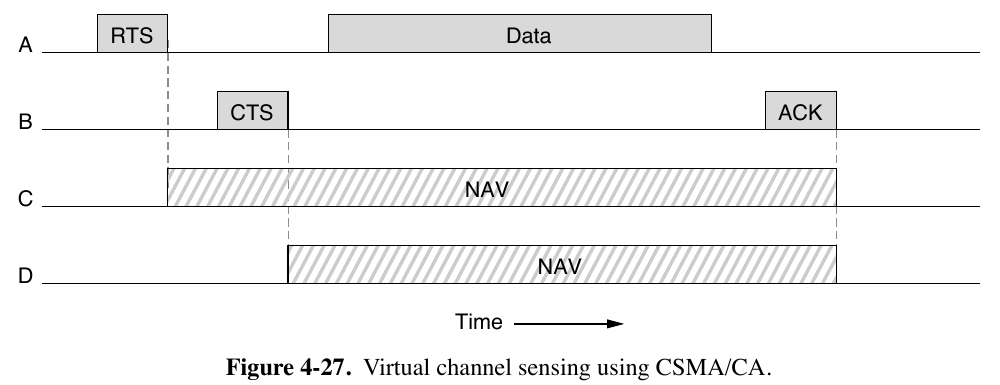

# Exercício 4.24

## Enunciado

A Fig. 4-27 mostra quatro estações, A, B, C e D. Das duas últimas, qual você acha que está mais perto de A, e por quê?

---

## Resolução — @Pins

O NAV da estação C começa logo depois do RTS da A, o que indica que a mesma ouviu o RTS, já o NAV da D é logo depois do CTS da B o que indica que D ouviu apenas o CTS, logo C está mais próxima de A do que D.

**Confiança:** alta  
**Referência:** subcapítulo 4.4.3 - The 802.11 MAC Sublayer Protocol

---

## Resolução — @outro-usuario

_(uma segunda resolução vai aqui embaixo, não substitua a de cima)_

---

## Discussão

_(divergências entre as resoluções, o que ficou em aberto)_
