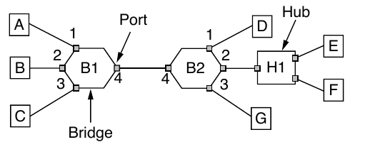

# Exercício 4.26

## Enunciado

Veja a Fig. 4-33(b). Imagine que todas as estações, pontes e hubs mostrados na figura são estações sem fio, e que as ligações indicam que duas estações estão no alcance uma da outra. Se B2 está transmitindo para D quando B1 quer transmitir para A e H1 quer transmitir para F, quais pares de estações são terminais ocultos ou expostos?

---

## Resolução — @Pins

Quando B2 está transmitindo para D, e B1 quer transmitir para A, B1 é um terminal exposto, pois está ao alcance de B2 mas quer transmitir para A que está fora do alcance de B2. E se H1 quer transmitir para F, H1 também é um terminal exposto pois está ao alcance de B2 mas quer transmitir para F que está fora do alcance de B2. Não há terminal oculto, pois ninguém alcança D, A ou F sem ouvir o respectivo transmissor.

**Confiança:** alta  
**Referência:** subcapítulo 4.2.5 - Wireless LAN Protocols

---

## Resolução — @outro-usuario

_(uma segunda resolução vai aqui embaixo, não substitua a de cima)_

---

## Discussão

_(divergências entre as resoluções, o que ficou em aberto)_
