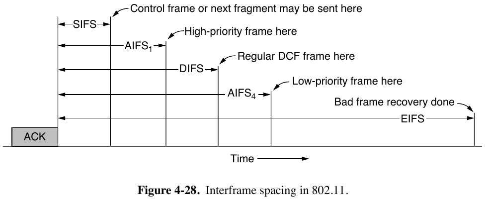

# Exercício 4.30

## Enunciado

A Fig. 4-28 mostra diferentes tempos de espera no 802.11 para quadros com prioridades diferentes. Essa abordagem impede que o tráfego de alta prioridade, como quadros com dados de tempo real, fique preso atrás do tráfego comum. Qual é uma desvantagem dessa abordagem?

---

## Resolução — @Pins

A grande desvantagem desta proposta é que ela pressupõe que as estações são honestas com relação à definição de prioridade de seus quadros. Além disso, se o tráfego de alta prioridade for contínuo, o de baixa prioridade pode nunca conseguir transmitir.

**Confiança:** alta  
**Referência:** subcapítulo 4.4.3 - The 802.11 MAC Sublayer Protocol

---

## Resolução — @outro-usuario

_(uma segunda resolução vai aqui embaixo, não substitua a de cima)_

---

## Discussão

_(divergências entre as resoluções, o que ficou em aberto)_
