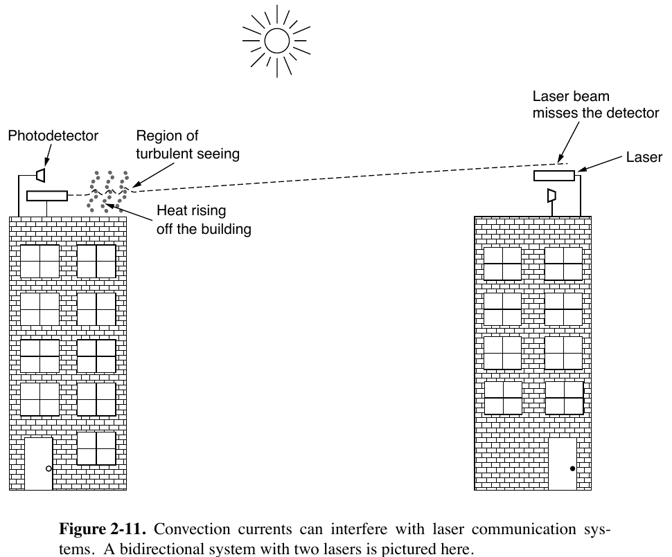

# Exercício 4.34

## Enunciado

Imagine uma rede em que as estações se comunicam por feixes de laser, como no arranjo mostrado na Fig. 2-11. Explique em que esse arranjo se parece e em que difere tanto do Ethernet quanto do 802.11, e como isso afetaria o projeto de sua camada de enlace de dados e de seus protocolos MAC.

---

## Resolução — @Pins

* **Parecido com o Ethernet** - como no Ethernet comutado full-duplex, cada feixe é um enlace ponto a ponto dedicado, um em cada sentido, então não há meio compartilhado nem colisão.

* **Parecido com o 802.11** - o sinal vai pelo ar, sujeito a calor, chuva e neblina (Fig. 2-11), com taxa de erros bem maior que a de um cabo.

* **Diferente dos dois** - o feixe é direcional e exige linha de visada: uma terceira estação não ouve a transmissão. Não há broadcast natural nem terminais ocultos ou expostos.

* **Efeito no projeto** - o MAC fica praticamente desnecessário, sem CSMA/CD nem CSMA/CA. Já a camada de enlace precisa, como no 802.11, de detecção ou correção de erros, ACK e retransmissão para lidar com o meio ruidoso.

**Confiança:** média  
**Referência:** subcapítulo 2.3 - Using the Spectrum for Transmission e subcapítulos 4.3 e 4.4

---

## Resolução — @outro-usuario

_(uma segunda resolução vai aqui embaixo, não substitua a de cima)_

---

## Discussão

_(divergências entre as resoluções, o que ficou em aberto)_
