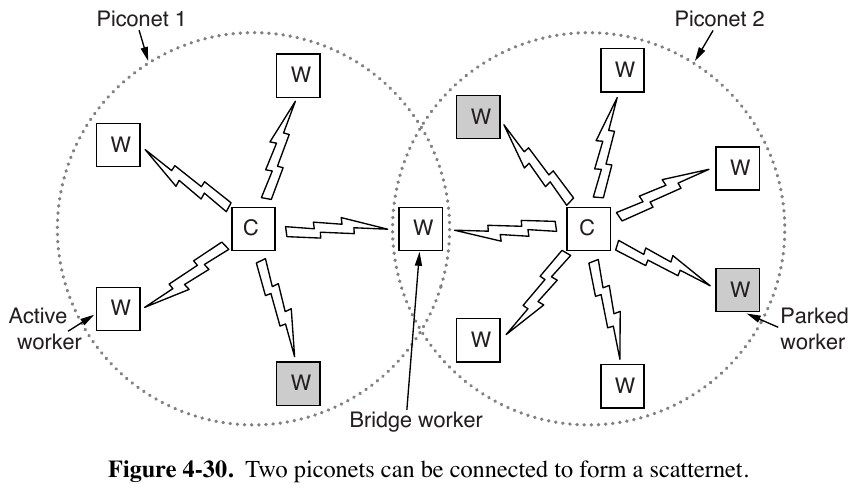

# Exercício 4.35

## Enunciado

Pela Fig. 4-30, vemos que um dispositivo Bluetooth pode estar em duas piconets ao mesmo tempo. Há algum motivo pelo qual um dispositivo não possa ser o controlador (controller) das duas ao mesmo tempo?

---

## Resolução — @Pins

Sim, porque a piconet é definida pelo seu controlador: é ele que controla o relógio, a divisão dos slots de tempo (TDM) e a sequência de saltos de frequência. Se o mesmo dispositivo fosse controlador das duas, elas teriam o mesmo relógio e a mesma sequência de saltos, ou seja, seriam uma única piconet, limitada a 7 workers ativos.

**Confiança:** alta  
**Referência:** subcapítulos 4.5.1 - Bluetooth Architecture e 4.5.4 - The Bluetooth Radio Layer

---

## Resolução — @outro-usuario

_(uma segunda resolução vai aqui embaixo, não substitua a de cima)_

---

## Discussão

_(divergências entre as resoluções, o que ficou em aberto)_
